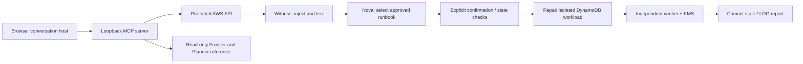

# NULL / REBIRTH

**Proof before recovery.** An Alexa+ experience simulation for a bounded recovery lab on AWS.

Ask for status, prepare a repair, review the proposed action, and confirm it. PATCH applies the approved fix. LOG reports what the checks and signed evidence actually show.

This project uses a browser host to simulate an Alexa+ conversation. It is **not connected to an Alexa account or an Echo**. The host has a constrained intent router; Amazon Nova Micro performs the live diagnosis and reporting. A self-hosted MCP server uses the official Python SDK and Streamable HTTP. Protocol version **2025-11-25** was explicitly negotiated in the interoperability test.

## Start with recorded evidence (no AWS account or key)

Requires Python 3.12 or newer. Tested on Windows with Python 3.14. Use an isolated virtual environment; this project uses the v2 MCP SDK.

```sh
python -m venv .venv
# Windows PowerShell:
.venv/Scripts/Activate.ps1
# macOS/Linux: source .venv/bin/activate
python -m pip install -r requirements.txt
python alexa_sim/run.py
```

Open **http://127.0.0.1:8768/**. The default mode reads a saved AWS run. Try:

1. `Alexa, what is the incident status?` — reads the recorded state, checks and report.
2. `Alexa, what evidence is missing?` — evaluates Proof Frontier on a labelled synthetic reference model.
3. `Alexa, plan the next evidence.` — recommends reference probes; no probes execute and the cost units are illustrative.

Recorded evidence cannot authorize a new repair. The simulator binds only to loopback. Do not expose this development host to the public internet. Its endpoint is **http://127.0.0.1:8768/mcp/**; an official MCP client can list its seven tools.

## Live AWS lab (judges with the shared review key)

Open the command bridge URL in the private judging instructions. Enter the privately supplied review key. Select one of 25 incident experiments and choose **RUN INCIDENT**. **REPLAY** displays saved state without another diagnosis or repair.

To run the conversational simulation against that same deployment, save the key in a local file outside this repository. Do not put it in a URL, source file or video.

```powershell
$env:NR_MODE='aws'
$env:NR_LAB_URL='<URL from private judging instructions>'
$env:NR_REVIEW_KEY_FILE='C:/private/review-access.token'
python alexa_sim/run.py
```

Then use these requests in order:

1. `Alexa, start the member API lab.`
2. `Alexa, prepare a repair.`
3. Read PATCH's diagnosis and the approved runbook; then `Alexa, confirm the approved repair.`

Preparing injects the selected synthetic fault and requests a diagnosis. It does not apply the repair. Confirmation expires after 120 seconds and is bound to the run, revision and plan. It can be consumed once. Wait for **COMPLETE**, 25 passing checks and LOG's report. The simulator permits at most five new runs per process; the deployment has lifetime limits of 300 runs and 600 model calls. A rejected proposal can trigger up to three diagnosis attempts.

The exhibition deployment is scheduled for deletion on **December 1, 2026 at 20:00 JST**, with a retry on December 2. After that, use recorded mode. The cost target is $5; alarms and counters reduce exposure but are not an exact billing cap.

## Conversation history

**New chat** creates a conversation; **Threads** selects an earlier one. **Select** enables multiple selection, and **Delete selected** shows the names and count before deletion. Cancel keeps every message. Conversations persist in this browser's local storage, not across devices. Deleting a conversation removes its browser copy; it does not delete AWS audit evidence. The original recorded demonstration is seeded once, and is not re-imported after you delete it. Repair confirmation and run selection are bound to the conversation on the local server. After restarting that server, start a fresh lab for further writes.

## What is real, and what is modelled

- **Real in live mode:** MCP requests, Lambda workers, DynamoDB state changes, Nova diagnosis/reporting, functional probes and KMS verification.
- **Synthetic:** workload records, fault injection, member API/device/session policies and the reference evidence model. The lab never connects to the organizations in the incident reports. It does not contain leaked personal records.
- **Reference advice:** Proof Frontier distinguishes missing proof from known failure. Proof Acquisition Planner suggests evidence acquisition within modelling units. These read-only tools do not authorize the live repair.
- **Normalization:** passing functional checks and signed state evidence gate normalization. The original business-resume proof lab separately exercises atomic claim/order checks. The conversational `inspect_resume_gate` tool creates no business order.

The 25 experiments cover recovery and containment. Three examples are restoring a verified snapshot after a GitLab-inspired database failure, bounding retries after an AWS-inspired overload, and requiring scoped access after a Sourcenext-inspired member API abuse disclosure. All incident source URLs and adaptation boundaries are in `cloud/incidents.py`.

## Architecture



The seven Lambda functions have separate roles. Two DynamoDB tables separate workflow state from audit records. Model output is structured data, not executable code. The runbook, target, failed checks and stored revision must agree before a repair. Containment requires unauthorized reads to fail, legitimate reads to work, and original evidence to remain intact.

## Validation

```powershell
$env:PYTHONPATH='.;source'
python -m pytest tests_cloud tests_alexa -q
python tools/verify_containment_evidence.py C:/private/CONTAINMENT_VALIDATION.json C:/private/CONTAINMENT_VALIDATION.json C:/private/CONTAINMENT_VALIDATION.json
# With the local simulator running:
python alexa_sim/verify_interop.py
```

- **167 local tests passed:** 133 backend tests and 34 simulator boundary and conversation tests.
- **Six AWS acceptance cases:** five containment cases and one recovery regression, 25 functional checks each. Six exported signatures verified offline; all six altered payloads were rejected.
- **One additional MCP-to-AWS run:** 25/25 checks, three unauthorized requests denied, legitimate reads and evidence preserved, KMS signature verified. Two model calls. Its KMS result is the backend verification flag; a separate offline signature export was not collected for this additional run.
- **MCP interop:** official SDK client, explicit 2025-11-25 negotiation, seven tools, invalid case rejected, unconfirmed repair rejected and untrusted Origin rejected.

See `evidence/aws/` and `evidence/public-tests.xml`. Public records omit account IDs, deployment endpoints and original signed attestations whose bodies include key identifiers. The original signature bundle is supplied privately to judges; do not use a redacted record as a signature-verification input. Public records omit account IDs, deployment endpoints and original signed attestations whose bodies include key identifiers. The original signature bundle is supplied privately to judges; do not use a redacted record as a signature-verification input. Public records omit account IDs, deployment endpoints and original signed attestations whose bodies include key identifiers. The original signature bundle is supplied privately to judges; do not use a redacted record as a signature-verification input. These are dated test records, not a guarantee of future AI output.

## Deployment source

`cloud/` contains runtime, UI and CloudFormation generation. `source/rpp_v15/` and `source/rpp_v16/` contain the pure reference policy/planner used here. `tools/build_cloud.py` creates packages locally without contacting AWS. Deployment tools stage changes as prepare → review → execute; they are administrator utilities, not necessary for judging. The template contains the exhibition's fixed names, region and cleanup dates. Public administrator utilities require NR_ACCOUNT_ID and the cleanup utility also requires NR_KMS_KEY_ID. Public administrator utilities require NR_ACCOUNT_ID and the cleanup utility also requires NR_KMS_KEY_ID. Public administrator utilities require NR_ACCOUNT_ID and the cleanup utility also requires NR_KMS_KEY_ID. Review those before adapting it to another account. Do not run an old dated template as a general-purpose production deployment.

## Tradeoffs and next work

Role separation, conditional updates and signed evidence make each repair inspectable. A serverless backend avoids always-on compute. The constraints also limit the system: it cannot freely repair unknown or compound faults, a shared review key does not identify individual judges, and the audit log is not WORM storage. One test needed three model proposals; rejected proposals changed no workload data.

For production, use individual OIDC identities, an independent signing account, immutable evidence storage and live infrastructure-specific probes. Actual Alexa+ host and Echo testing remains future work.

## Credits and license

Code and original cat SVG assets: **MIT**, see [LICENSE](LICENSE). No anime artwork or Amazon product logos are included. AI-assisted development used Codex; live diagnosis/reporting uses Amazon Nova Micro. Demo voice: **Ondoku (ondoku3.com)**. Original demo music was generated with **Suno Pro**; downloaded audio and rendered videos are not part of this code repository or its MIT grant.

Primary references: [MCP transport specification](https://modelcontextprotocol.io/specification/2025-11-25/basic/transports), [official Python SDK](https://github.com/modelcontextprotocol/python-sdk), [DynamoDB transactions](https://docs.aws.amazon.com/amazondynamodb/latest/developerguide/transactions.html), [KMS signing](https://docs.aws.amazon.com/kms/latest/APIReference/API_Sign.html).
